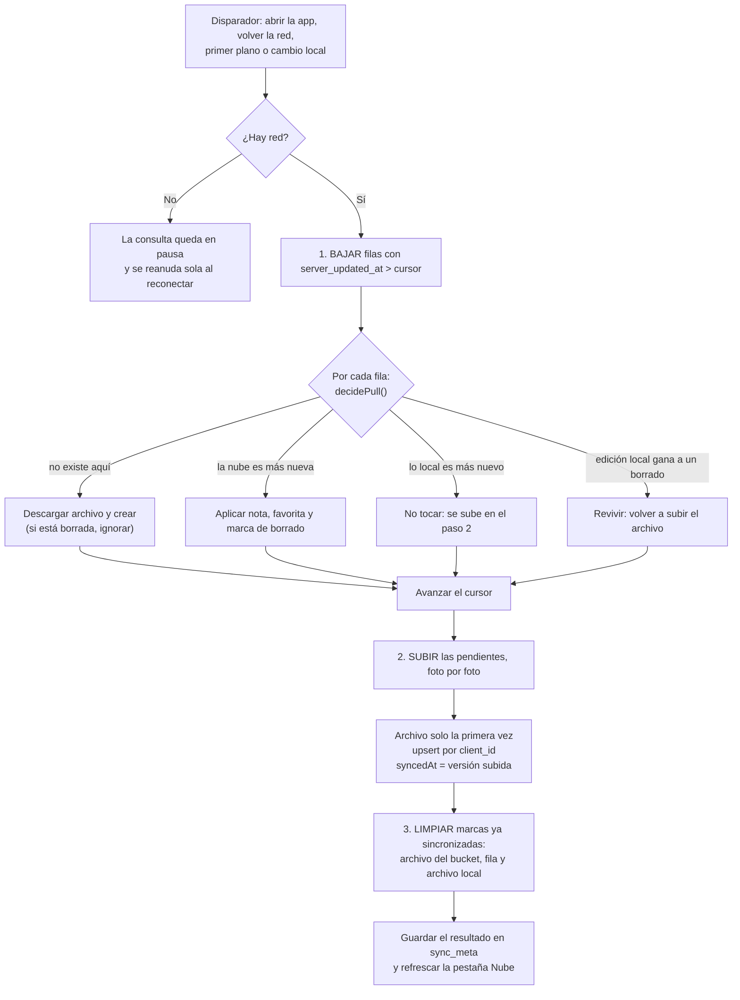
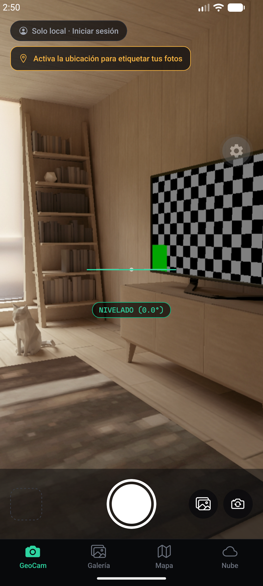
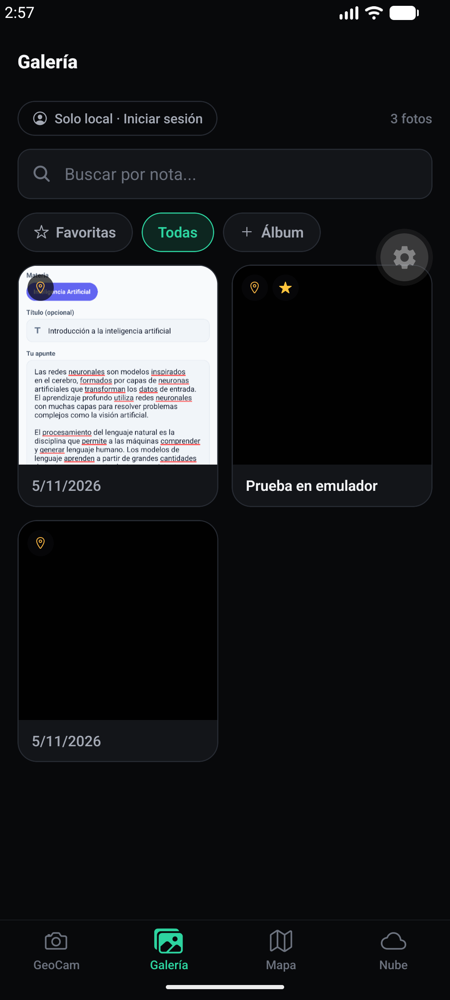
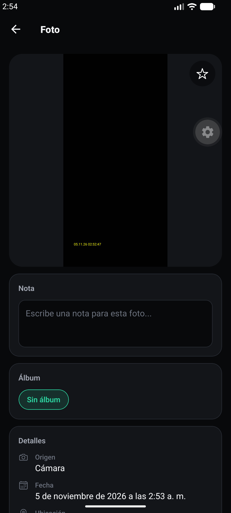
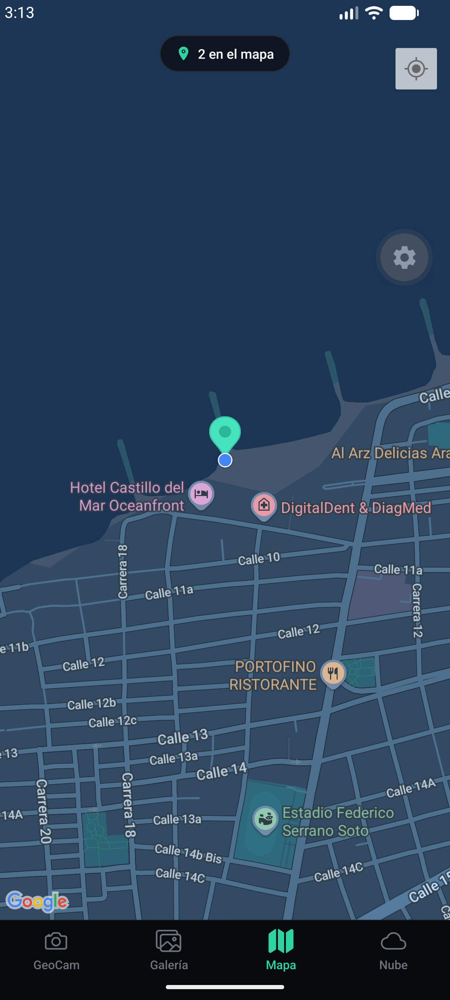
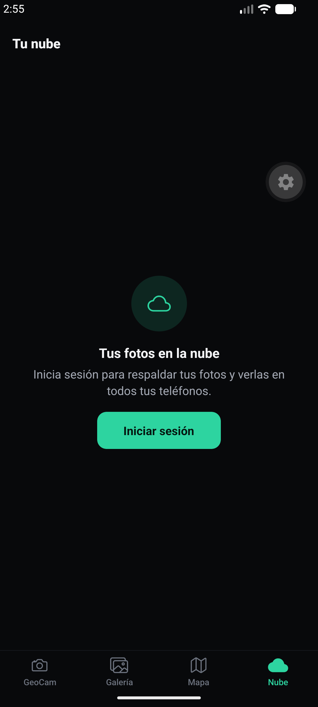
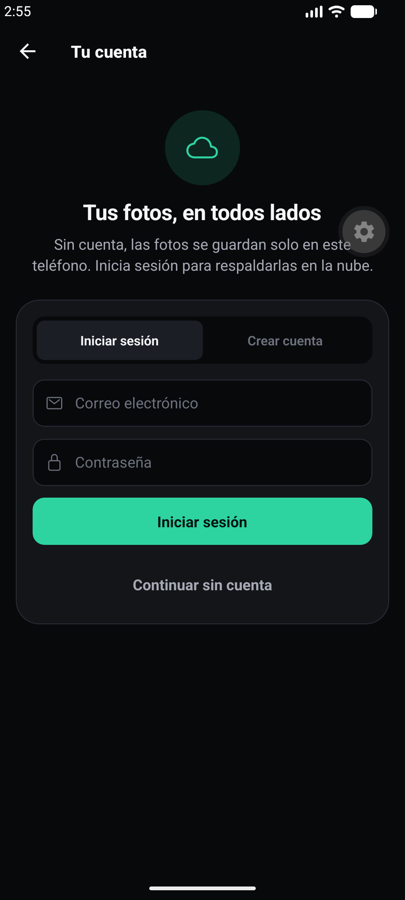
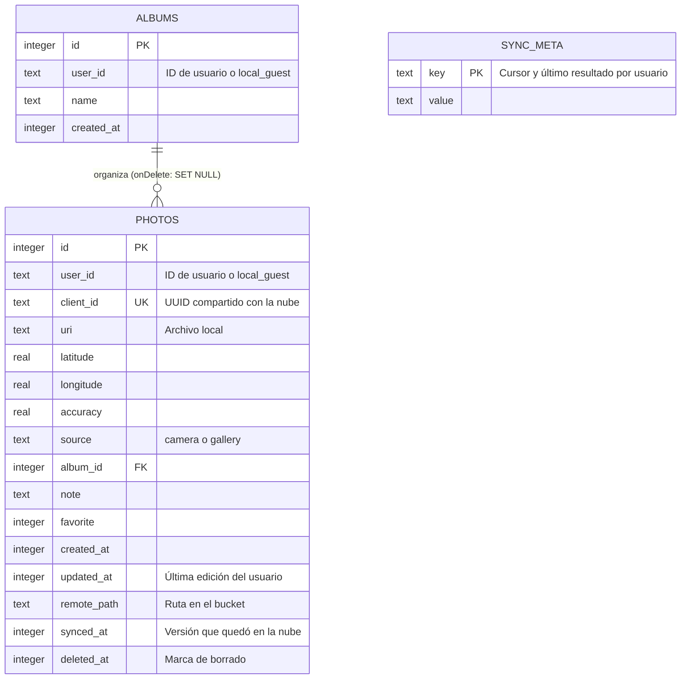

# GeoCam: cámara geolocalizada offline-first con sincronización en dos sentidos

**Integrantes:** Deivis Magdaniel, Edgar Zuñiga
**Proyecto:** Taller Integrador 2, Programación Móvil Avanzada
**Tecnologías:** Expo SDK 58, TypeScript, Expo Router, Drizzle ORM y SQLite, Supabase (Auth, PostgreSQL, Storage), TanStack Query 5, Reanimated 4.

La app trabaja normal sin conexión. Cuando vuelve la red, sube sola lo pendiente y baja lo que cambió en otro teléfono con la misma cuenta, incluidos los borrados. La pestaña **Nube** muestra lo que hay en Supabase con un feed paginado.

---

## Cómo ejecutarlo

1. **Supabase.** En el SQL Editor ejecuta `supabase_schema.sql` y después `supabase_semana9.sql`, una sola vez cada uno.
2. **Credenciales.** Copia `.env.example` como `.env` y coloca la URL y la llave pública del proyecto.
3. **Instalar y correr.**

   ```bash
   npm install
   npx expo start -c
   ```

4. **Abrir.** Usa Expo Go para el SDK 58, la versión actual, en el teléfono o el emulador.

| Comando | Para qué |
| --- | --- |
| `npm test` | Pruebas automáticas (88) |
| `npm run typecheck` | Revisión de tipos |
| `npm run lint` | Lint |

---

## Arquitectura

```text
Pantallas (app/)              no importan Supabase ni Drizzle
    │
Hooks (hooks/)                useSync, useCloudFeed, usePhotos, usePhoto
    │
    ├── Repositorios (db/repositories/)   SQLite con Drizzle: la fuente de verdad
    ├── Sincronización (services/sync.ts) el ciclo de bajar, subir y limpiar
    ├── Reglas (services/syncRules.ts)    funciones puras, sin base de datos ni red
    ├── Nube (services/cloudPhotos.ts)    la única capa que le habla a la tabla y al bucket
    └── Archivos (services/photoFiles.ts) expo-file-system
```

### Qué hace TanStack Query y qué es diseño propio

TanStack Query no sincroniza bases de datos: administra peticiones y caché. Decide **cuándo** se ejecuta el ciclo, lo reintenta si falla y lo pausa sin red. **Qué** se sube, qué se baja y quién gana un conflicto es diseño propio, y está en `services/`.

---

## Diseño de la sincronización

1. **SQLite es la fuente de verdad.** La app siempre lee y escribe en local; la UI nunca espera a la nube.
2. **Identidad compartida.** Cada foto tiene un `clientId` (UUID creado en el teléfono). El id autoincremental solo vale dentro de un dispositivo.
3. **Marca de pendiente.** Una foto está pendiente si `syncedAt` está vacío o es anterior a `updatedAt`.
4. **Cursor de bajada.** El teléfono guarda en `sync_meta` el `server_updated_at` del último cambio que bajó y pide solo lo posterior.
5. **Conflictos: gana el último cambio.** Queda la versión con `updatedAt` más reciente.
6. **Borrar es marcar.** Se pone `deletedAt`, la UI oculta la foto y la marca viaja como cualquier otro cambio. Los archivos se eliminan cuando la marca ya está sincronizada.

### El ciclo



### Dos relojes

| Columna remota | Quién la escribe | Para qué sirve |
| --- | --- | --- |
| `updated_at` | El teléfono, con la hora en que el usuario editó | Decidir quién gana un conflicto |
| `server_updated_at` | PostgreSQL, con un trigger | Cursor de bajada: "dame lo que llegó después de X" |

### La regla de conflicto, con un ejemplo

La foto tiene la nota `"Playa"`. Los dos teléfonos están en modo avión.

| Hora | Teléfono A | Teléfono B | Nube |
| --- | --- | --- | --- |
| 10:00 | Nota `"Playa de día"`, `updatedAt = 10:00` | | `"Playa"` |
| 10:01 | | Nota `"Atardecer"`, `updatedAt = 10:01` | `"Playa"` |
| 10:05 | Reconecta: baja (nada nuevo) y sube | | `"Playa de día"`, `updated_at = 10:00` |
| 10:06 | | Reconecta: baja, compara 10:00 con 10:01 y gana lo local. Sube | `"Atardecer"`, `updated_at = 10:01` |
| 10:07 | Vuelve a sincronizar: la nube es más nueva y la aplica | | `"Atardecer"` |

Los dos terminan con `"Atardecer"`, sin importar quién reconecte primero. La regla es `remoteWins()` en `services/syncRules.ts`. La edición de A se pierde: es aceptable para notas personales, no lo sería para un saldo bancario.

### Cuándo se dispara

`hooks/useSync.ts` trata la sincronización como una consulta de TanStack Query.

| Disparador | Cómo |
| --- | --- |
| Abrir la app o iniciar sesión | `enabled: !!userId` |
| Recuperar la red | `refetchOnReconnect: 'always'` y `onlineManager` con `expo-network` |
| Volver a primer plano | `refetchOnWindowFocus: 'always'` y `focusManager` con `AppState` |
| Cada cambio local | `requestSync()` invalida la consulta; sin red queda en pausa |
| A mano | Botón "Sincronizar ahora" en la pantalla de estado |

### Decisiones que van más allá de la guía

| Decisión | Qué problema evita |
| --- | --- |
| Trigger `reject_stale_photo_update` en PostgreSQL | Otro teléfono puede escribir entre la bajada y la subida. Si llega una versión más vieja, el servidor la descarta |
| `clock_timestamp()` en vez de `now()`, y releer 5 s antes del cursor | Filas con la misma hora, o confirmadas tarde, que el cursor se saltaría |
| El cursor no avanza más allá de una fila que falló | Una foto que no se pudo descargar no se pierde, y tampoco bloquea a las demás |
| Decisión `revive` en `decidePull` | Borrada en A y editada después en B: gana la edición, pero el archivo ya salió del bucket. B lo vuelve a subir |
| `nextVersion()`: la versión siempre avanza | Con el reloj atrasado, una edición quedaría con fecha anterior a `syncedAt` y nunca se subiría |
| `applyRemote` solo escribe si la versión local sigue siendo más vieja | No pisa una edición hecha durante la descarga |
| Un solo ciclo por usuario, con una vuelta extra si llegó un cambio durante él | Ciclos en paralelo y cambios que quedarían esperando |
| Bucket privado con URLs firmadas | Las fotos llevan ubicación: antes cualquiera con la URL podía verlas |
| Sin política `DELETE` en la tabla | Un borrado directo dejaría a los demás teléfonos sin enterarse |

---

## Pestaña Nube (`app/(tabs)/nube.tsx`)

- `useInfiniteQuery` sobre la tabla remota, con **paginación por cursor** (`client_created_at`) de a 10.
- **Infinite scroll** en `FlatList`, con deslizar para refrescar.
- **Búsqueda en vivo** por nota, con espera de 400 ms y sin parpadeo (`keepPreviousData`).
- **Caché que sobrevive al cierre** con `@tanstack/react-query-persist-client`. Solo se guarda el feed, nunca el estado de la sincronización, y se elimina al cerrar sesión.
- Con copia local de la foto, muestra esa imagen: así también se ve sin conexión.

| Estado | Qué muestra |
| --- | --- |
| Carga | Tarjetas de esqueleto con la forma del contenido |
| Error | Mensaje y botón "Reintentar" |
| Vacío | Mensaje distinto si hay búsqueda o no |
| Sin conexión, con datos | Aviso y la lista guardada |
| Sin conexión, sin datos | Pide conectarse |
| Falla una recarga o la página siguiente | La lista se conserva y el error se puede reintentar |

---

## Pantalla de estado (`app/sincronizacion.tsx`)

Muestra las fotos pendientes, la fecha de la última sincronización, cuántas subieron, bajaron y se borraron, el último error con el detalle por foto y el botón "Sincronizar ahora". El resultado se guarda en SQLite, así que sigue disponible después de cerrar la app.

---

## Diseño de la interfaz

- **Tema único** en `constants/theme.ts`: colores, espacios y tamaños.
- **Componentes** en `components/ui/`: `AnimatedPressable`, `Button`, `Chip`, `Banner`, `EmptyState`, `Skeleton` y `SearchField`.
- **Animaciones con Reanimated:** botones con resorte, entrada escalonada de tarjetas, reacomodo al filtrar o borrar, iconos de pestaña, indicador de sincronización que gira, obturador con destello y miniatura que aparece al capturar. Las entradas respetan la opción de reducir movimiento del sistema.
- **Vibración** leve con `expo-haptics` en acciones principales, e **imágenes** con `expo-image`.

---

## Pruebas

### Matriz C6

**Automático:** el código real de `services/sync.ts` y de los repositorios corre con SQLite real y las migraciones reales, contra un servidor en memoria que imita las reglas de los triggers y de RLS. Salida completa en [`docs/evidencia/pruebas-automaticas.txt`](docs/evidencia/pruebas-automaticas.txt).

**Teléfonos reales:** un iPhone y un emulador Android, con la misma cuenta y el proyecto real de Supabase. Horas, detalles y límites en [`docs/evidencia/pruebas-con-telefonos.md`](docs/evidencia/pruebas-con-telefonos.md).

| # | Escenario | Resultado esperado | Obtenido (automático) | Obtenido (teléfonos reales) |
| --- | --- | --- | --- | --- |
| 1 | Foto tomada sin conexión; luego se reconecta | Se sube sola; pendientes vuelve a 0 | ✅ 2 fotos suben, pendientes 2 → 0, archivo en el bucket | ✅ En el emulador subieron solas unos 7 s después de volver la red |
| 2 | Foto creada en el teléfono A | Aparece en B con imagen y ubicación | ✅ Aparece con nota, coordenadas y archivo; no se vuelve a subir | ✅ Del iPhone al emulador, con imagen, ubicación y pin |
| 3 | Nota editada en A y después en B, ambos sin conexión | En los dos queda la nota de B | ✅ Probado con A primero y con B primero | ⚠️ Quedó la más reciente en los dos, pero solo el emulador estaba sin red |
| 4 | Foto borrada en A | Desaparece en B y del bucket | ✅ La fila queda como marca; archivo fuera del bucket y de los dos teléfonos | ✅ Marca y archivo confirmados en Supabase, también con un borrado sin red desde el iPhone |
| 5 | Foto editada en A y borrada después en B, ambos sin conexión | Queda borrada en los dos | ✅ Probado con A primero y con B primero | ✅ La edición sin red del emulador no llegó a la nube y la foto no revivió |
| 6 | Se corta la red a mitad de una sincronización de 5 fotos | Termina sin duplicar filas ni archivos | ✅ Probado con un corte en cada una de las 11 peticiones: siempre 5 filas y 5 archivos | ✅ El corte dejó una foto con archivo y sin fila; terminó con 5 filas y 5 archivos |
| 7 | Se cierra la app con fotos pendientes y se abre con red | Se sincroniza al abrir | ✅ La pendiente sobrevive en una base en disco, y el ciclo se dispara al montar | ✅ Con la app cerrada sin red, subió al abrirla |

### Otras pruebas automáticas

| Archivo | Qué comprueba |
| --- | --- |
| `sync.matrix.test.ts` | La matriz, errores por foto (C5), idempotencia, ediciones durante la subida, cursor, más de 200 cambios, reloj atrasado, revivir fotos, corte durante la limpieza, separación por usuario |
| `syncRules.test.ts` | La regla de conflicto y la tabla de decisiones, como funciones puras |
| `migrations.test.ts` | Las migraciones sobre una base con datos de la versión anterior: no se pierde ninguna foto |
| `useSync.triggers.test.tsx` | Cada disparador, la pausa sin red y los reintentos |
| `cloudPhotos.test.ts` | Cursor sin repetidos cuando llega una foto nueva, búsqueda, comodines, borradas |
| `nube.screen.test.tsx` | Los estados de UI, infinite scroll, búsqueda con una sola petición |
| `persist.test.ts` | La caché sobrevive, y no guarda la sincronización ni los errores |
| `authMessages.test.ts` | Registro con correo ya existente, cuenta por confirmar y errores en español |

### Pruebas contra PostgreSQL real

Los triggers y las políticas RLS se probaron en el proyecto de Supabase, dentro de una transacción que se revierte al final. Script y resultado en [`docs/evidencia/pruebas-postgres.md`](docs/evidencia/pruebas-postgres.md).

### Revisión en el emulador de Android

La app corrió en Expo Go (SDK 58) en un emulador Android 17, primero en modo invitado, con cámara virtual, SQLite y mapa reales. Las capturas son de ese modo. Las pruebas con cuenta están en la matriz de arriba.

| Comprobado | Resultado |
| --- | --- |
| Migraciones al abrir, permisos de cámara y ubicación | ✅ |
| Tomar fotos e importar desde la galería | ✅ Se guardan y aparecen en Galería y Mapa |
| Nota, favorita, crear álbum y aviso de borrado | ✅ |
| Borrar una foto de tres | ✅ Quedan exactamente dos, y el aviso del invitado no menciona la nube |
| Cerrar y volver a abrir la app | ✅ Las fotos siguen ahí |
| Pines en el mapa y panel de fotos sin ubicación | ✅ |
| Pestaña Nube y pantalla de cuenta como invitado | ✅ |

| Cámara | Galería | Detalle |
| :---: | :---: | :---: |
|  |  |  |

| Mapa | Nube (invitado) | Cuenta |
| :---: | :---: | :---: |
|  |  |  |

Las fotos tomadas en el emulador salen negras con un sello de fecha: es lo que entrega su cámara virtual. Una imagen importada se ve normal. El botón del engranaje es una herramienta de Expo Go, no de la app.

### Qué no se ha probado

- **Dos teléfonos físicos.** Se usaron un iPhone y un emulador Android.
- **Escenario 3 con los dos teléfonos sin red.** Solo está cubierto por las pruebas automáticas.

### Prueba sin conexión (GIF)

> **Pendiente de grabar en el teléfono.** Guárdalo como `docs/prueba-sin-conexion.gif` y reemplaza esta nota por ``.
>
> Pasos: inicia sesión, activa modo avión, toma dos fotos y edita una nota. El indicador muestra "Sin conexión · 3 pendientes" o similar. Quita el modo avión: pasa a "Sincronizando…" y después a "Al día" sin tocar nada.

---

## Limitaciones conocidas

- **"Gana el último cambio" pierde la edición más antigua** y depende de que la hora de los teléfonos sea razonable.
- **Los álbumes son locales:** solo se sincronizan la foto, la nota, la favorita y el borrado.
- **Las marcas de borrado se quedan en la tabla para siempre**, porque un teléfono que lleve meses sin conectarse todavía debe recibirlas.
- **La sesión se guarda en `AsyncStorage`, no en SecureStore**, sin cifrar en el teléfono.
- **Las fotos de invitado no pasan a la cuenta** al iniciar sesión: siguen separadas en `local_guest`.
- **Dos fotos con el mismo milisegundo** justo en el borde de una página del feed: la segunda se saltaría. El cursor es solo la fecha, como propone la guía.
- **Ventana mínima al revivir una foto:** si un teléfono elimina el archivo justo después de que otro lo volvió a subir, la descarga falla y queda reportada como error de esa foto.
- `geocam_albums` y `geocam_deleted_records` quedaron sin uso en Supabase. No se borraron para no destruir datos.
- **La sincronización no es instantánea:** un cambio de otro teléfono llega al abrir la app, al volver a primer plano, al recuperar la red o tras un cambio local.
- **Reto opcional** (conservar las dos versiones de la nota): no se hizo.

---

## Preguntas para sustentar

**¿Por qué se baja antes de subir?** Para comparar antes de escribir. Si se subiera primero, un cambio local viejo pisaría uno remoto más nuevo antes de poder compararlos.

**¿Para qué sirven dos columnas de fecha?** `updated_at` dice cuándo editó el usuario y decide los conflictos. `server_updated_at` dice cuándo llegó el cambio al servidor y es el cursor. Con una sola, una foto editada sin conexión el lunes y subida el miércoles tendría fecha de lunes, y un teléfono que sincronizó el martes nunca la bajaría.

**¿Qué significa que la subida sea idempotente?** Que hacerla una vez o diez deja el mismo resultado: el upsert es por `client_id` y la ruta del archivo sale del `clientId`. Por eso TanStack Query puede reintentar sin crear duplicados.

**¿Por qué un borrado no puede ser un `DELETE` directo?** Porque una fila borrada no deja rastro que bajar: los demás teléfonos nunca se enterarían, y además volverían a subir la foto.

**¿Qué hace TanStack Query y qué es diseño propio?** TanStack Query ejecuta, reintenta, pausa y dispara. Qué se sube, qué se baja y quién gana es diseño propio, en `services/`.

---

## Base de datos local



### Migraciones (`drizzle/`)

| Migración | Qué hace |
| --- | --- |
| `0000_absent_blindfold` | Tabla `photos` |
| `0001_absent_patch` | Tabla `albums`; columnas `album_id`, `note` y `favorite` |
| `0002_steep_slyde` | Partición por `user_id`, columnas de respaldo y `sync_queue` |
| `0003_sync_bidireccional` | `client_id`, `updated_at`, `remote_path`, `synced_at`, `deleted_at` y `sync_meta`. Rellena los datos existentes y convierte `sync_queue` en marcas de borrado |
| `0004_quitar_columnas_antiguas` | Quita `remote_id`, `remote_url`, `sync_status`, `last_synced_at` y `sync_queue` |

---

## Funciones de semanas anteriores

- **Cámara y sensores** (`app/(tabs)/geocam.tsx`): ciclo de permisos completo, nivelador con `DeviceMotion` y borrado al agitar con `Accelerometer`.
- **Mapa** (`app/(tabs)/mapa.tsx`): pines con vista previa y panel de fotos sin ubicación.
- **Galería** (`app/(tabs)/galeria.tsx`): búsqueda por nota, filtros por álbum y favoritas, creación de álbumes.
- **Detalle** (`app/foto/[id].tsx`): nota, favorita, álbum y borrado; se actualiza solo si otro teléfono cambia la foto.
- **Datos por usuario:** cada consulta filtra por `userId`, con modo invitado (`local_guest`) 100 % local. En Supabase, RLS y carpetas por usuario en el bucket.

### Evidencia de los tres estados de permiso

Estas imágenes son de la versión anterior de la interfaz.

| Concedido | Rechazado | Bloqueado |
| :---: | :---: | :---: |
|  |  |  |

---

## Registro de IA

El uso de IA en cada semana está documentado en [`AI-LOG.md`](AI-LOG.md).
