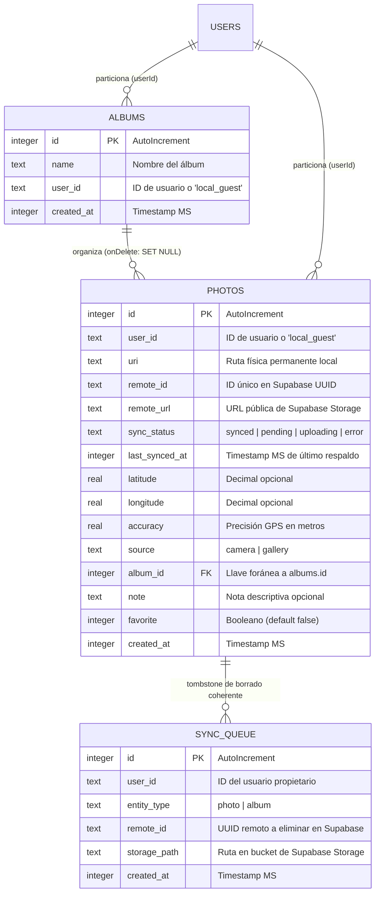

# GeoCam — Módulos Nativos, Sensores, SQLite Offline-First y Respaldo Confiable en Supabase

**Integrantes:** Deivis Magdaniel, Edgar Zuñiga  
**Proyecto:** Taller Integrador 2 — Módulos Nativos, Persistencia Offline-First y Nube  
**Tecnologías:** React Native, Expo SDK 57, TypeScript, Drizzle ORM, SQLite (`expo-sqlite`), Supabase (Auth, PostgreSQL, Storage), Expo Sensors, Expo FileSystem, Expo Network.

---

## 🏗️ Arquitectura de Datos Offline-First + Respaldo en la Nube

La aplicación combina un motor local offline-first con sincronización asíncrona hacia Supabase (PostgreSQL y Storage), garantizando disponibilidad total sin internet y respaldo seguro en la nube:

$$\text{Pantalla (UI)} \longrightarrow \text{Hooks / SyncManager} \longrightarrow \begin{cases} \text{SQLite Local (Drizzle ORM + expo-sqlite)} \\ \text{Almacenamiento Local (Expo FileSystem)} \\ \text{Supabase Cloud (PostgreSQL + Storage + Auth)} \end{cases}$$

1. **Pantallas (`app/`):** Consumen datos reactivos mediante hooks (`usePhotos`, `useAlbums`, `useSync`, `useAuth`). **Ninguna pantalla accede directamente a SQLite ni a consultas raw de Supabase.**
2. **Contexto de Autenticación (`context/AuthContext.tsx`):** Maneja la sesión con Supabase Auth y persistencia segura en `AsyncStorage`. Permite alternar entre **Modo Invitado** (almacenamiento 100% local) y **Usuario Autenticado**.
3. **Repositorios (`db/repositories/`):** Construyen sentencias SQL con Drizzle ORM particionando cada consulta por `userId`.
4. **Administrador de Sincronización (`services/syncManager.ts`):** Orquesta los 4 pilares de sincronización entre SQLite y Supabase con detección de red (`expo-network`).
5. **Almacenamiento Físico Permanente (`services/photoFiles.ts`):** Gestiona los archivos en `Paths.document/photos` con la API moderna de `expo-file-system`, integrando copiado local, borrado físico y descarga desde URLs remotas.

---

## ☁️ Los 4 Pilares del Respaldo Confiable con Supabase

### 1. Sincronización de Pendientes
* **Detección de Red:** Antes de cualquier intento de sincronización, `syncManager.isOnline()` verifica la conectividad mediante `expo-network`.
* **Cola de Subida:** Cada foto capturada o editada en estado offline se marca con `syncStatus: 'pending'`.
* **Subida en 2 Fases:**
  1. El archivo binario local se sube a Supabase Storage en el bucket `geocam-photos` bajo la ruta `{userId}/{photoId}_{timestamp}.jpg`.
  2. La URL pública y los metadatos (coordenadas GPS, nota, favorito, origen, fecha) se registran en la tabla `geocam_photos` en PostgreSQL.
* **Transición de Estado:** Al confirmarse la subida, el registro local en SQLite actualiza su estado a `synced` registrando `remoteId`, `remoteUrl` y `lastSyncedAt`.

### 2. Borrado Coherente
* **Cola Local de Eliminaciones (`sync_queue`):** Si una foto o álbum sincronizado se borra localmente (incluso sin internet), se almacena un registro en la tabla local `sync_queue` con el `remoteId` y `storagePath`.
* **Purgado Remoto Inmediato o al Reconectar:** Cuando hay conectividad, el `syncManager`:
  1. Elimina físicamente el archivo del bucket de Supabase Storage.
  2. Borra la fila correspondiente en la tabla `geocam_photos` de Supabase.
  3. Registra una entrada en `geocam_deleted_records` para que otros dispositivos del mismo usuario eliminen la foto localmente en su próxima sincronización.
  4. Limpia el elemento de la cola `sync_queue`.

### 3. Consulta de la Nube (Descarga y Restauración)
* **Descarga Multi-dispositivo:** `syncManager.fetchCloudPhotos(userId)` consulta todas las fotos del usuario en Supabase que no existan aún en el SQLite local.
* **Persistencia Física Automática:** Cada foto descargada se guarda en el almacenamiento permanente local (`Paths.document/photos`) usando `File.downloadFileAsync`, permitiendo que la galería funcione sin internet tras el primer sync.
* **Sincronización de Borrados:** Si una foto fue borrada desde otro dispositivo, se detecta a través de `geocam_deleted_records` y se elimina del SQLite y del almacenamiento local.

### 4. Datos Locales Separados por Usuario
* **Partición Local por `userId`:** Tanto las tablas locales (`photos`, `albums`, `sync_queue`) como las remotas (`geocam_photos`, `geocam_albums`) contienen la columna `userId`.
* **Aislamiento Multi-inquilino Local:** Todas las consultas SQL (`photosRepo.listQuery`, `albumsRepo.listQuery`, etc.) filtran estrictamente por el `userId` activo (`eq(photos.userId, currentUserId)`).
* **Modo Invitado (`local_guest`):** Los usuarios pueden usar la app de forma ilimitada sin crear cuenta; sus datos se etiquetan con `userId = 'local_guest'` y nunca se suben a la nube. Al iniciar sesión, se aíslan de las fotos de los usuarios autenticados.
* **Row Level Security (RLS) en Supabase:** Políticas estrictas en PostgreSQL y Supabase Storage garantizan que `auth.uid() = user_id`, impidiendo que un usuario acceda, modifique o borre datos de otro.

---

## 🗄️ Diagrama Entidad-Relación (SQLite con Drizzle ORM)



---

## 🚀 Migraciones Versionadas (`drizzle/`)

1. **Migración 1 (`drizzle/0000_absent_blindfold.sql`):**
   * Creación inicial de la tabla `photos` con geolocalización, metadata de origen (`camera` / `gallery`) y timestamps.
2. **Migración 2 (`drizzle/0001_absent_patch.sql`):**
   * Creación de la tabla `albums` con restricción de unicidad en `name`.
   * Agregado no destructivo de las columnas `album_id` (FK `set null`), `note` (texto) y `favorite` (booleano).
3. **Migración 3 (`drizzle/0002_steep_slyde.sql`):**
   * Incorporación de partición por usuario: `user_id` con valor por defecto `'local_guest'`.
   * Columnas de sincronización con la nube: `remote_id`, `remote_url`, `sync_status` y `last_synced_at`.
   * Creación de la tabla `sync_queue` para garantizar el borrado coherente offline.
4. **Ejecución en arranque:** El `RootLayout` (`app/_layout.tsx`) utiliza `useMigrations(db, migrations)` para bloquear la navegación hasta que las migraciones pendientes se apliquen exitosamente.

---

## 📦 Módulos y Funcionalidades Desarrolladas

### 1. Centro de Autenticación y Sincronización (`app/auth.tsx`)
* Registro e inicio de sesión con correo y contraseña contra Supabase Auth.
* Indicador en tiempo real de fotos pendientes por subir a la nube.
* Botón de **Sincronización Manual Inmediata** (`Sincronizar ahora`).
* Botón de **Restauración desde la Nube** (`Descargar respaldo de la nube`).
* Acceso con un toque como **Invitado Local**.
* Cierre de sesión seguro con limpieza de estado en `AsyncStorage`.

### 2. Badge de Estado de Sincronización (`components/SyncStatusBadge.tsx`)
* Presente en el encabezado de la Galería y en la pantalla de la Cámara.
* Indica visualmente:
  * 🔄 *Sincronizando...* (subida o descarga en progreso).
  * ⚠️ *N pendientes* (fotos en cola para respaldo).
  * ☁️ *Respaldo al día* (todo sincronizado).
  * 📱 *Local (Invitado)* (toque para iniciar sesión).
* Al tocar el badge, abre modal directo a la pantalla de Autenticación y Respaldo.

### 3. CRUD Completo de Fotografías y Detalle (`app/foto/[id].tsx`)
* Visualización a pantalla completa con metadata técnica:
  * Origen (`camera` / `gallery`), fecha, coordenadas y precisión GPS.
  * **Estado en la nube:** ☁️ Sincronizada, ⏳ Pendiente o 🔄 Subiendo.
  * **Fecha del último respaldo** y **Partición de usuario**.
* Edición y guardado reactivo de notas con auto-reencolado para sincronización.
* Marcado y desmarcado de favoritas.
* Reubicación entre álbumes mediante chips interactivos.
* **Borrado Coherente:** Eliminación local simultánea (DB y FileSystem) y encolado en `sync_queue` para purgar Supabase Storage y PostgreSQL.

### 4. Galería Reactiva y Filtros (`app/(tabs)/galeria.tsx`)
* Buscador reactivo por texto de nota.
* Filtro por álbum y botón para crear álbumes.
* Filtro toggle para fotos favoritas.
* Consultas reactivas en vivo con `useLiveQuery` particionadas por usuario.

### 5. Cámara con Hardware Nativo y Sensores (`app/(tabs)/geocam.tsx`)
* **Ciclo de permisos determinista:** `checking` $\to$ `undetermined` $\to$ `granted` $\to$ `denied` $\to$ `blocked`.
* **Nivelador con horizonte artificial (`hooks/useCameraLevel.ts`):** Sensor `DeviceMotion` fusionado para nivelación en pantalla ($\le 1.5^\circ$).
* **Sensor de sacudida (`hooks/useShake.ts`):** Umbral de aceleración de $1.8\text{ g}$ con cooldown de $1000\text{ ms}$ para borrado seguro mediante alerta nativa.

---

## 📱 Evidencia Visual de los Tres Estados de Permiso

| 1. Concedido (`granted`) | 2. Rechazado (`denied`) | 3. Bloqueado (`blocked`) |
| :---: | :---: | :---: |
|  |  |  |
| *Cámara activa, nivelador a 0.0° y GPS en vivo.* | *Degradación elegante: cámara activa y banner contextual.* | *PermissionPrimer con redirección a Ajustes.* |

---

## ⚙️ Configuración del Backend en Supabase

El archivo `supabase_schema.sql` en la raíz contiene las sentencias DDL y RLS listas para ejecutar en el SQL Editor de Supabase:

1. **Creación de tablas:** `geocam_albums`, `geocam_photos` y `geocam_deleted_records`.
2. **Creación del bucket de Storage:** `geocam-photos` (acceso público para lectura y escritura restringida por usuario).
3. **Políticas Row Level Security (RLS):**
   * Cada usuario solo puede ver, insertar, actualizar y eliminar sus propios registros (`auth.uid() = user_id`).
   * Los archivos en Supabase Storage solo pueden ser manipulados por el usuario dueño de la carpeta (`(storage.foldername(name))[1] = auth.uid()::text`).

## 📂 Estructura del Repositorio

```text
├── app/
│   ├── (tabs)/
│   │   ├── _layout.tsx          # Pestañas GeoCam, Galería y Mapa
│   │   ├── geocam.tsx           # Visor de cámara y captura
│   │   ├── galeria.tsx          # Lista reactiva, buscador y filtros (C4)
│   │   ├── mapa.tsx             # Visualización reactiva en MapView (T5)
│   │   └── index.tsx            # Redirección inicial
│   ├── foto/
│   │   └── [id].tsx             # Pantalla CRUD detalle, notas y álbum (C3)
│   └── _layout.tsx              # Root Layout con migrador useMigrations (T2)
├── components/
│   ├── CameraLevelIndicator.tsx # Horizonte artificial con DeviceMotion
│   └── PermissionPrimer.tsx     # Diálogo de recuperación de permisos bloqueados
├── db/
│   ├── client.ts                # Conexión openDatabaseSync y PRAGMA foreign_keys
│   ├── schema.ts                # Esquema Drizzle: photos y albums (C1, C2)
│   └── repositories/
│       ├── photos.ts            # Repositorio desacoplado de fotos (T3)
│       └── albums.ts            # Repositorio desacoplado de álbumes
├── drizzle/                     # Migraciones versionadas generadas por drizzle-kit
│   ├── 0000_absent_blindfold.sql# Migración inicial
│   ├── 0001_absent_patch.sql    # Segunda migración con relaciones y campos
│   └── migrations.js            # Bundle de migraciones para Expo
├── hooks/
│   ├── usePhotos.ts             # Hook reactivo de fotos con useLiveQuery (T4)
│   ├── useAlbums.ts             # Hook reactivo de álbumes
│   ├── useCamera.ts             # Cámara con CameraView
│   ├── useCameraLevel.ts        # Sensor de nivelación
│   ├── useGeoLocation.ts        # Seguimiento GPS
│   └── useShake.ts              # Sensor de movimiento
├── services/
│   └── photoFiles.ts            # Persistencia física de archivos con Expo FileSystem (C5)
├── types/
│   ├── geo.ts                   # Tipos de coordenadas y permisos
│   └── declarations.d.ts        # Tipado de módulos .sql y migrations.js
├── AI-LOG.md                    # Registro de auditoría de IA (Semanas 6 y 7)
├── babel.config.js              # Plugin inline-import para .sql
├── metro.config.js              # Soporte de extensión sql en Metro
├── drizzle.config.ts            # Configuración de Drizzle Kit
└── app.json                     # Configuración de plugins nativos
```

---

## 🚀 Instrucciones de Ejecución

1. **Instalar dependencias:**
   ```bash
   npm install
   ```

2. **Ejecutar el proyecto con caché limpia:**
   ```bash
   npx expo start -c
   ```

3. **Verificación de tipos estricta:**
   ```bash
   npx tsc --noEmit
   ```
