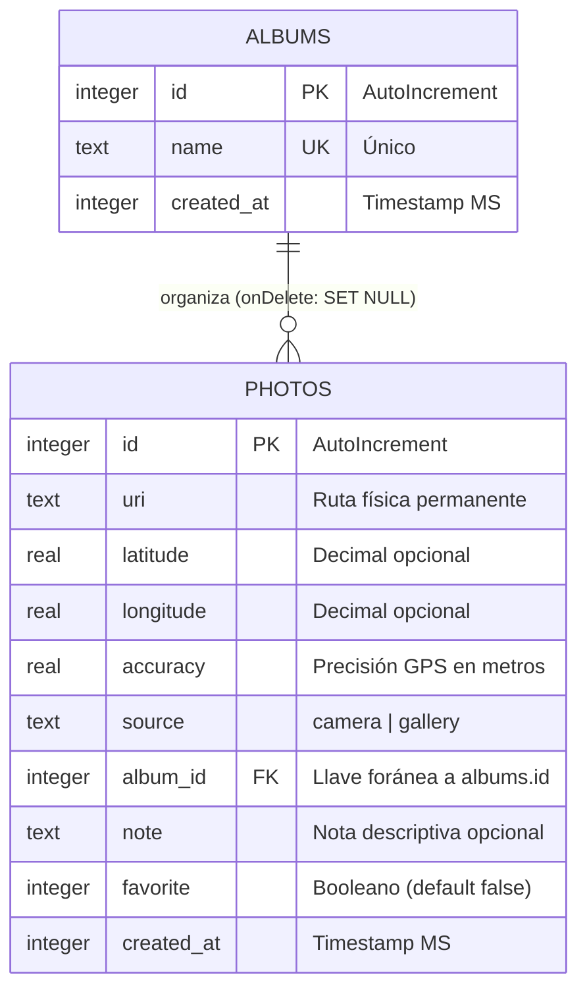
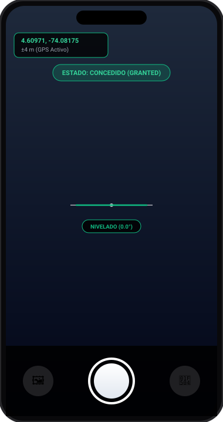
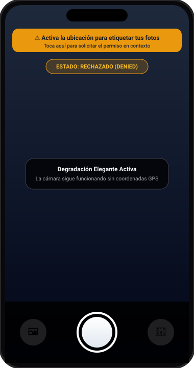

# GeoCam — Módulos Nativos, Sensores y Base de Datos Local Offline-First

**Integrantes:** Deivis Magdaniel, Edgar Zuñiga  
**Proyecto:** Taller Integrador 2 — Semanas 6 y 7  
**Tecnologías:** React Native, Expo SDK 57, TypeScript, Drizzle ORM, SQLite (`expo-sqlite`), Expo Sensors, Expo FileSystem.

---

## 🏗️ Arquitectura de Datos Offline-First

La aplicación implementa una arquitectura por capas desacoplada en cinco niveles, garantizando persistencia local inmediata y type-safety integral:

$$\text{Pantalla (UI)} \longrightarrow \text{Custom Hook (Reactividad)} \longrightarrow \text{Repositorio (SQL)} \longrightarrow \text{Drizzle ORM} \longrightarrow \text{expo-sqlite (.db)}$$

1. **Pantallas (`app/`):** Consumen datos a través de hooks. **Ninguna pantalla importa directamente Drizzle ni SQLite.**
2. **Hooks (`hooks/`):** Conectan las consultas reactivas de `useLiveQuery` con acciones de mutación.
3. **Repositorios (`db/repositories/`):** Única capa que construye las sentencias SQL con Drizzle (`listQuery`, `withLocationQuery`, `create`, `update`, `remove`).
4. **Drizzle Client (`db/client.ts`):** Instancia de Drizzle sobre `expo-sqlite` configurada con `enableChangeListener: true` y ejecución de `PRAGMA foreign_keys = ON;`.
5. **Almacenamiento Permanente (`services/photoFiles.ts`):** Las fotos se transfieren de la caché temporal al directorio permanente de documentos de la aplicación (`Paths.document/photos`). Al eliminar el registro en base de datos, el archivo físico se destruye.

---

## 🗄️ Diagrama Entidad-Relación (Base de Datos SQLite)



* **Regla de integridad:** `onDelete: 'set null'` garantiza que si un álbum es eliminado, sus fotos asociadas no se destruyen, sino que pasan al estado *"Sin álbum"*.

---

## 🚀 Migraciones Versionadas (`drizzle/`)

Se implementó el ciclo de migraciones automáticas sin pérdida de datos para clientes móviles:

1. **Migración 1 (`drizzle/0000_absent_blindfold.sql`):**
   * Creación inicial de la tabla `photos` con geolocalización, metadata de origen (`camera` / `gallery`) y timestamps.
2. **Migración 2 (`drizzle/0001_absent_patch.sql`):**
   * Creación de la tabla `albums` con restricción de unicidad en `name`.
   * Agregado no destructivo de las columnas `album_id` (FK), `note` (texto) y `favorite` (booleano con valor por defecto `false`).
3. **Protección en arranque:** El `RootLayout` (`app/_layout.tsx`) utiliza `useMigrations(db, migrations)` para bloquear la navegación hasta que las migraciones pendientes se apliquen exitosamente, evitando consultas sobre tablas incompletas.

---

## 📦 Módulos y Funcionalidades Desarrolladas

### 1. CRUD Completo de Fotografías
* **Crear:** Captura con cámara nativa o importación desde galería. Los binarios se copian a almacenamiento permanente y las coordenadas se asocian en la base de datos.
* **Leer y Filtrar (`app/(tabs)/galeria.tsx`):**
  * Buscador en vivo por texto de nota (`like`).
  * Filtro dinámico por álbumes y botón para crear nuevos álbumes.
  * Filtro toggle para fotos favoritas (`favorite = true`).
  * Consultas reactivas automáticas gracias a `useLiveQuery`.
* **Detalle y Edición (`app/foto/[id].tsx`):**
  * Visualización a pantalla completa con metadata técnica.
  * Edición y guardado de notas.
  * Marcado/desmarcado de favorito en tiempo real.
  * Reubicación de álbum mediante chips interactivos.
* **Eliminar:** Diálogo de confirmación con borrado simultáneo en SQLite y en el sistema de archivos (`services/photoFiles.ts`).

### 2. Mapa Interactivo de Fotos (`app/(tabs)/mapa.tsx`)
* Pines interactivos sobre fotos georreferenciadas.
* Vista previa tooltip (*Callout*) con miniatura, notas y acceso directo al detalle de la foto.
* Drawer inferior deslizable para fotos tomadas sin permiso GPS (*Sin ubicación*).

### 3. Cámara con Hardware Nativo y Sensores
* **Ciclo de permisos determinista:** `checking` $\to$ `undetermined` $\to$ `granted` $\to$ `denied` $\to$ `blocked`.
* **Nivelador con horizonte artificial (`hooks/useCameraLevel.ts`):** Sensor `DeviceMotion` fusionado para nivelación en pantalla ($\le 1.5^\circ$).
* **Sensor de sacudida (`hooks/useShake.ts`):** Umbral de aceleración de $1.8\text{ g}$ con cooldown de $1000\text{ ms}$ para borrado seguro mediante alerta nativa.

---

## 📱 Evidencia Visual de los Tres Estados de Permiso

| 1. Concedido (`granted`) | 2. Rechazado (`denied`) | 3. Bloqueado (`blocked`) |
| :---: | :---: | :---: |
|  |  |  |
| *Cámara activa, nivelador a 0.0° y GPS en vivo.* | *Degradación elegante: cámara activa y banner contextual.* | *PermissionPrimer con redirección a Ajustes.* |

---

## 📂 Estructura del Repositorio

```text
├── app/
│   ├── (tabs)/
│   │   ├── _layout.tsx          # Pestañas GeoCam, Galería y Mapa
│   │   ├── geocam.tsx           # Visor de cámara y captura
│   │   ├── galeria.tsx          # Lista reactiva, buscador y filtros (C4)
│   │   ├── mapa.tsx             # Visualización reactiva en MapView (T5)
│   │   └── index.tsx            # Redirección inicial
│   ├── foto/
│   │   └── [id].tsx             # Pantalla CRUD detalle, notas y álbum (C3)
│   └── _layout.tsx              # Root Layout con migrador useMigrations (T2)
├── components/
│   ├── CameraLevelIndicator.tsx # Horizonte artificial con DeviceMotion
│   └── PermissionPrimer.tsx     # Diálogo de recuperación de permisos bloqueados
├── db/
│   ├── client.ts                # Conexión openDatabaseSync y PRAGMA foreign_keys
│   ├── schema.ts                # Esquema Drizzle: photos y albums (C1, C2)
│   └── repositories/
│       ├── photos.ts            # Repositorio desacoplado de fotos (T3)
│       └── albums.ts            # Repositorio desacoplado de álbumes
├── drizzle/                     # Migraciones versionadas generadas por drizzle-kit
│   ├── 0000_absent_blindfold.sql# Migración inicial
│   ├── 0001_absent_patch.sql    # Segunda migración con relaciones y campos
│   └── migrations.js            # Bundle de migraciones para Expo
├── hooks/
│   ├── usePhotos.ts             # Hook reactivo de fotos con useLiveQuery (T4)
│   ├── useAlbums.ts             # Hook reactivo de álbumes
│   ├── useCamera.ts             # Cámara con CameraView
│   ├── useCameraLevel.ts        # Sensor de nivelación
│   ├── useGeoLocation.ts        # Seguimiento GPS
│   └── useShake.ts              # Sensor de movimiento
├── services/
│   └── photoFiles.ts            # Persistencia física de archivos con Expo FileSystem (C5)
├── types/
│   ├── geo.ts                   # Tipos de coordenadas y permisos
│   └── declarations.d.ts        # Tipado de módulos .sql y migrations.js
├── AI-LOG.md                    # Registro de auditoría de IA (Semanas 6 y 7)
├── babel.config.js              # Plugin inline-import para .sql
├── metro.config.js              # Soporte de extensión sql en Metro
├── drizzle.config.ts            # Configuración de Drizzle Kit
└── app.json                     # Configuración de plugins nativos
```

---

## 🚀 Instrucciones de Ejecución

1. **Instalar dependencias:**
   ```bash
   npm install
   ```

2. **Ejecutar el proyecto con caché limpia:**
   ```bash
   npx expo start -c
   ```

3. **Verificación de tipos estricta:**
   ```bash
   npx tsc --noEmit
   ```
